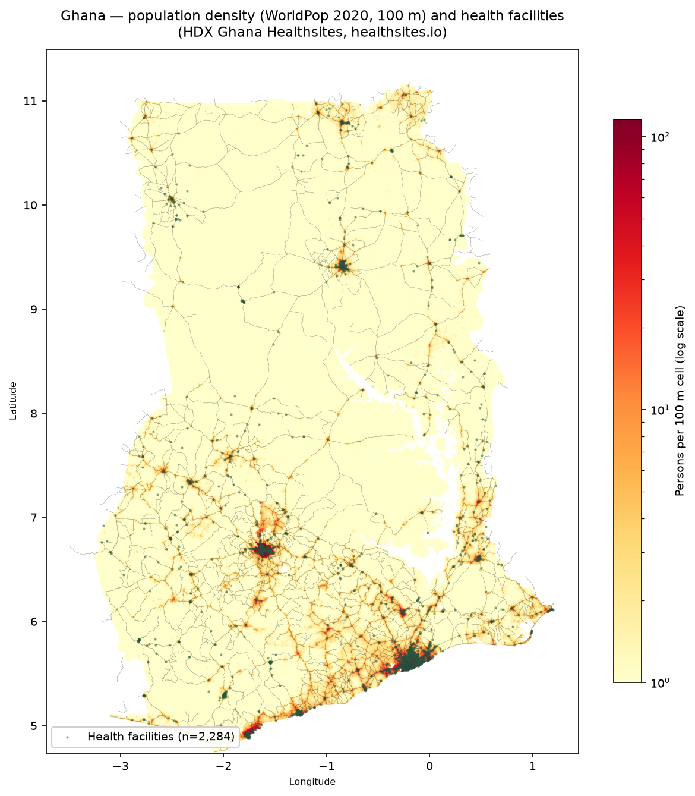
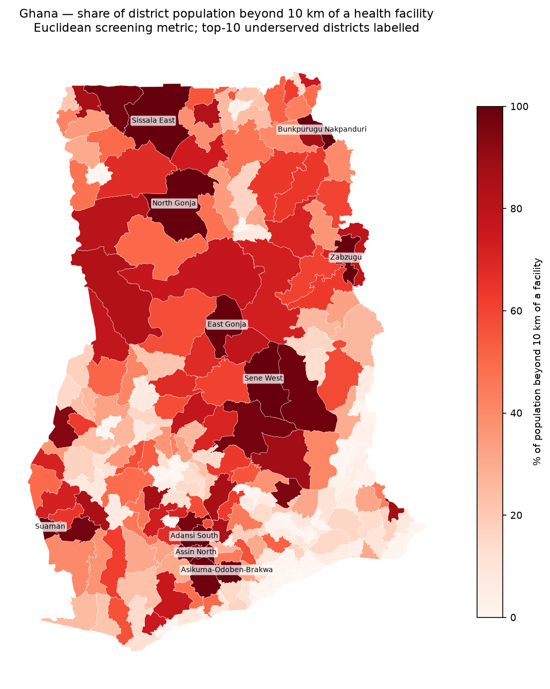

# Ghana Health-Facility Accessibility Analysis

How close is the nearest health facility for every community in Ghana — and
which districts are most underserved? This project combines open health
facility locations, WorldPop population estimates, and GADM district
boundaries to produce population-weighted coverage statistics for all 260
districts (MMDAs) of Ghana.

## Results (computed, not hand-entered)

National coverage — share of Ghana's population (33,039,564, WorldPop 2020)
within a straight-line distance of the nearest health facility:

| Metric | All facilities (n=2,284) | Clinical only (n=1,099) |
|---|---|---|
| Population within 5 km | 56.59% | 53.86% |
| Population within 10 km | 74.59% | 72.59% |
| Population beyond 10 km | 8,396,914 | 9,055,860 |
| Pop.-weighted mean distance | 7.02 km | 7.60 km |
| Pop.-weighted median distance | 3.61 km | 4.19 km |
| Pop.-weighted 90th percentile | 18.45 km | 19.47 km |

"Clinical only" excludes pharmacies (sensitivity analysis — see Limitations).

Most underserved districts (% of population beyond 10 km). Note: the eight
districts at 100% have **zero mapped facilities** in the healthsites.io
dataset — this reflects OSM under-mapping of remote areas at least as much as
true absence of care (see Limitations):

| District | Region | Population | Facilities | per 10k | % beyond 10 km |
|---|---|---|---|---|---|
| Suaman | Western North | 27,138 | 0 | 0.00 | 100.00 |
| Sissala East | Upper West | 91,809 | 0 | 0.00 | 100.00 |
| Zabzugu | Northern | 117,141 | 0 | 0.00 | 100.00 |
| East Gonja | Savannah | 43,590 | 0 | 0.00 | 100.00 |
| North Gonja | Savannah | 48,126 | 0 | 0.00 | 100.00 |
| Bunkpurugu Nakpanduri | North East | 129,371 | 0 | 0.00 | 100.00 |
| Sene West | Bono East | 85,905 | 0 | 0.00 | 100.00 |
| Adansi South | Ashanti | 67,885 | 0 | 0.00 | 100.00 |
| Asikuma-Odoben-Brakwa | Central | 139,750 | 0 | 0.00 | 99.47 |
| Assin North | Central | 131,974 | 0 | 0.00 | 99.40 |

Full per-district table: [`outputs/district_summary.csv`](outputs/district_summary.csv).
Machine-readable headline numbers: [`outputs/metrics.json`](outputs/metrics.json).

## Maps




## Data sources

| Dataset | Publisher | Accessed | File |
|---|---|---|---|
| Ghana Healthsites (healthsites.io extract) | Open Healthsite Consulting via HDX | 2026-10-07 | `data/gh*.geojson` (see `data/provenance.csv`) |
| WorldPop Ghana 2020, 100 m unconstrained | WorldPop / Univ. of Southampton | 2026-10-07 | `data/gha_ppp_2020.tif` (download only, git-ignored) |
| GADM v4.1 Ghana level 2 (260 districts) | GADM | 2026-10-07 | `data/gadm41_GHA_shp.zip` (download only, git-ignored) |
| Ghana OSM extract | Geofabrik / OSM contributors | 2026-10-07 | `data/ghana-latest.osm.pbf` (download only, git-ignored) |

Full provenance (exact URLs, access dates): [`data/provenance.csv`](data/provenance.csv).

## Methods

1. **Facilities** (`src/prepare_facilities.py`): HDX Ghana Healthsites GeoJSON →
   keep valid geometries (non-point geometries such as hospital campuses
   become representative points), drop points outside Ghana, drop exact
   duplicate coordinates. Result: `data/facilities.geojson` (+ a clinical-only
   subset without pharmacies).
2. **Coverage** (`src/coverage.py`): rasterize facilities onto the WorldPop
   100 m grid; Euclidean distance transform (`scipy.ndimage.distance_transform_edt`)
   with per-axis metre sampling; population-weighted aggregation. Saves
   `outputs/distance_km.tif` and `outputs/coverage_summary*.json`.
3. **Districts** (`src/districts.py`): zonal sums of population and
   beyond-10 km population per GADM level-2 district; facility counts by
   spatial join; facilities per 10,000 people. → `outputs/district_summary*.csv`.
4. **Maps** (`src/maps.py`): population + facilities map; underserved-district
   choropleth.
5. **Roads** (`src/extract_roads.py`): major highways (motorway→tertiary) pulled
   from the Geofabrik PBF with pyosmium (the Overpass API is unreachable from
   some networks, so the extract is processed locally).

## Limitations (read before citing)

- **Euclidean, not travel time.** Distances are straight-line; roads, terrain,
  rivers, and transport mode are not modelled. Treat this as a screening
  metric for where to look closer, not a travel-time estimate.
- **Facility completeness.** healthsites.io is community-mapped (OSM-derived);
  rural facilities are likely under-mapped, so "beyond 10 km" populations are
  a *lower bound* on the truly underserved.
- **Population is modelled.** WorldPop 2020 is an estimate, not a census.
- **Facility type mix.** The source mixes hospitals, clinics, pharmacies,
  dentists. The clinical-only sensitivity run excludes pharmacies.

## Reproduce

```bash
python -m venv .venv && source .venv/bin/activate
pip install -r requirements.txt
bash run_all.sh   # downloads data, runs the full pipeline into outputs/
```

Large rasters/PBFs are git-ignored; `run_all.sh` fetches them automatically.

## License

MIT — see [LICENSE](LICENSE).
